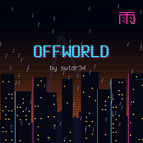

# OFFWORLD

A drone synth for the M-VAVE FM-1 by **swtdr34mz**, in the spirit of the great 80s sci-fi scores: colossal brass,
endless reverb, rain on neon. Built on [fm1-base](https://github.com/charlesvestal/fm1-base) and
[felucca-bsp](https://github.com/hugelton/felucca-bsp).

One engine, done well: two detuned saws per voice (or saw and pulse), a sine sub, a 24 dB filter with its own brass
envelope that swells open like a horn section, an ensemble chorus, a dark ping-pong delay and a reverb of eight lines
that rings up to 30 seconds, or forever (FREEZE). Every knob is a **macro** that rests on **sweetspots**: turn it
slowly and it stops for a few detents on each one, whose name lights up.

 

**Manual:** [English](docs/MANUAL.md) ([PDF](docs/OFFWORLD_MANUAL.pdf)) · [Deutsch](docs/HANDBUCH.md) ([PDF](docs/OFFWORLD_HANDBUCH.pdf))

**Install:** download the `.fwsc` from [Releases](https://github.com/swtdr34mz-afk/OFFWORLD/releases) and install it as any FM-1 firmware. Unofficial: not made or supported by M-VAVE; at your own risk.

## Version 0.4.1: no clicks, a new intro

- Settings are written to the flash only in a quiet moment (no note, no cue, no MEMORY), faded out first: a write stops the FM-1's sound for a moment, which was the click a few seconds after changing a preset or a knob.
- Every value that changes a chunk at a time now glides sample by sample (the filter in a fast attack, pressure); the limiter turns down over ~2 ms instead of at once; rain drops and thunder are soft, the neon hums instead of crackling; the delay rounds off instead of clipping.
- The intro: a terminal boots, the city rises out of the dark in the rain, searchlights, a car, the title buzzing on letter by letter, lightning, the name.

## Version 0.4: the world, the night, cues, memory

- **WORLD** (FX): what the screen shows, heard. Each scene has its own sound (traffic far below, a crowd at the noodle bar, wind, a hologram's hum, the plant, TV static, buzzing neon), and what happens in it sounds: a car flying past (moving from side to side with it), a sign crackling, a flame roaring, a siren far off, a bowl set down. CITY sets its level.
- **STORY**: a night told over 24 minutes, 19:00 to 07:00, with a clock in the corner. Dusk, the night, rain, the storm at one, the storm passing, dawn. RAIN is how wild the night gets at most. TIME moves the clock.
- **LOGS**: now and then a short line typed after the place (our own lines).
- **CUES** (ENV): SAVE keeps what sounds as a cue (up to 8). CUE plays one, sliding into it over FADE; AUTO moves through them every HOLD seconds. SAVE held 1 s on the page: every cue cleared.
- **MEMORY** (REC tapped): the last 3 seconds frozen into a cloud you play over; again: it fades.
- **The controls, drawn**: HOME twice.
- The keys show the scale with FOLLOW: its notes half lit, the root bright, the low split glowing. FOLLOW turns the split on. EPIC's fifth stays in the scale.
- RAIN CITY is gone; LAST SUNRISE is a new, brighter sound.

## Version 0.3: GLIDE, clean at full

- **GLIDE** (EDIT): LOW GLIDE and LOW MODE for the low split, GLIDE and MODE for the right hand (the whole keyboard with the split off). Time from off to 3 s. POLY: every note its own voice, gliding from the last note of its side. MONO: one voice a side, a new key slides it there without a new attack, always gliding. LEGATO: as MONO, gliding only when the notes overlap. With LOW HOLD and MONO the low drone slides from note to note; the DRONE's deep root slides with it.
- No more distortion: a limiter that turns the level down instead of clipping, the pulse wave at the saw's level, more room in the reverb.
- No more clicks when a voice is taken for a new note: it fades out in a few ms first.
- The two cores as a pipeline: the second renders the voices while the first runs the effects (5.8 ms later). The panel shows CPU and XR (late blocks).

## Version 0.2: the low split, pressure, the film

- **SPLIT** (SEL): the keys left of the split point play 1 to 3 octaves down. **LOW HOLD** (SEQ) keeps the low note(s) sounding on their own; a new low note replaces them, and the right hand plays free.
- **FOLLOW**: the right hand plays in **SCALE** (MINOR, DORIAN, PHRYGIAN, HARM MINOR, MAJOR, LYDIAN, PENTATONIC, ARABIC) from the low split's note. SNAP moves every key to the scale's note at or below it; WHITE puts the scale on the white keys.
- **PRESSURE** (GLO): pressing a key harder opens the FILTER, SWELLs it louder, gives it POWER (louder, brighter, the ensemble wide open, grit), or VIBRATO; AMOUNT says how much. MIDI polyphonic pressure does the same.
- Half the voices run on the FM-1's second core; the knobs' changes and preset changes glide (no clicks).
- The screen is a film: eight scenes of a city at night (skyline, noodle row, night flight, a hologram koi, the refinery, a wall of TVs, a neon alley, a rooftop with searchlights), panning sideways, cut at random with a tape glitch. Their windows, signs and screens light with the notes.

## Version 0.1

| Knob | Macro | Moves | Sweetspots |
| --- | --- | --- | --- |
| K1 | **SWELL** | the attacks (amp and filter), how far the filter falls back, the release | STAB, BRASS, SWELL, TIDE, ETERNAL |
| K2 | **DRIFT** | the oscillators apart, the pitch's slow drift, the ensemble, the stereo width; at the end tape wow and grit | CLEAN, CS, ENSEMBLE, WIDE, BROKEN |
| K3 | **SPACE** | the room's size and decay, its mix and darkness, the delay | ROOM, HALL, CATHEDRAL, CANYON, FREEZE |
| K4 | **RAIN** | synthesized rain: hiss, drops, the city's rumble; thunder far off at STORM and FLOOD | DRY, DRIZZLE, RAIN, STORM, FLOOD |

Presets: OFFWORLD BRASS, NEON TOWER, PYRAMID HALL, LAST SUNRISE, SKYLINE, DEEP SECTOR, ACID SKY. Each
keeps its own knobs.

## Controls

| Control | What it does |
| --- | --- |
| Keys | The brass, with velocity: harder is brighter |
| K1..K4 | SWELL, DRIFT, SPACE, RAIN |
| PRESET | The preset |
| SELECT | TONE: darker / brighter |
| ALGORITHM | VIBRATO: it comes in slowly after the note starts |
| PLAY | **DRONE** on / off: the notes stay. A key pressed with no key down starts a new chord. A deep root sounds an octave below the lowest note |
| ARP | **EPIC** on / off: one finger plays root, fifth and octave |
| SEQ | **LOW HOLD** on / off (turns the split on if it is off) |
| SEL | The SPLIT page: SPLIT, POINT, SCALE, FOLLOW (again: back). Held + a key: the split there |
| GLO | The PRESSURE page: PRESSURE, AMOUNT, TONE, VIBRATO (again: back) |
| EDIT | The GLIDE page: LOW GLIDE, LOW MODE, GLIDE, MODE (again: back) |
| FX | The WORLD page: CITY, STORY, LOGS, TIME |
| ENV | The CUES page: CUE, FADE, HOLD, AUTO |
| SAVE | What sounds kept as a cue |
| REC | MEMORY (held 1 s: every note let go) |
| HOME twice | The controls, drawn |
| HOME | Back to the main page |
| OCT- / OCT+ | The octave |
| HOME held 1 s | The preset's knobs back as they came |
| REC held 1 s | Every note let go |
| MIDI in | Notes on any channel (USB or TRS) |

The screen: a city at night. Every key has its window, lit while the note sounds; the flames burn higher when it's
loud; RAIN brings the rain on the screen too, and with it lightning. The blimp carries the preset's name.

Settings save themselves a few seconds after the last change (DRONE starts off).

## Roadmap

1. The engine, the four macros, DRONE, EPIC, the city (0.1)
2. The low split, LOW HOLD, FOLLOW, PRESSURE, the second core, the film (0.2)
3. GLIDE, the limiter, clean voice stealing, the cores as a pipeline (0.3, this version)
4. Pages: TONE (oscillators, filter), SPACE (reverb and delay in detail), MOD (vibrato, drift, a slow filter LFO)
5. More presets, the knobs' values per preset saved as user presets
6. A ribbon-style pitch bend on the knobs
7. More scenes
