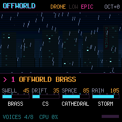

# OFFWORLD

A drone synth for the M-VAVE FM-1 by **swtdr34mz**, in the spirit of the great 80s sci-fi scores: colossal brass,
endless reverb, rain on neon. Built on [fm1-base](https://github.com/charlesvestal/fm1-base) and
[felucca-bsp](https://github.com/hugelton/felucca-bsp).

One engine, done well: two detuned saws per voice (or saw and pulse), a sine sub, a 24 dB filter with its own brass
envelope that swells open like a horn section, an ensemble chorus, a dark ping-pong delay and a reverb of eight lines
that rings up to 30 seconds, or forever (FREEZE). Every knob is a **macro** that rests on **sweetspots**: turn it
slowly and it stops for a few detents on each one, whose name lights up.

 

## Version 0.2: the low split, pressure, the film

- **SPLIT** (SEL): the keys left of the split point play 1 to 3 octaves down. **LOW HOLD** (SEQ) keeps the low note(s) sounding on their own; a new low note replaces them, and the right hand plays free.
- **FOLLOW**: the right hand plays in **SCALE** (MINOR, DORIAN, PHRYGIAN, HARM MINOR, MAJOR, LYDIAN, PENTATONIC, ARABIC) from the low split's note. SNAP moves every key to the scale's note at or below it; WHITE puts the scale on the white keys.
- **PRESSURE** (GLO): pressing a key harder opens the FILTER, SWELLs it louder, gives it POWER (louder, brighter, the ensemble wide open, grit), or VIBRATO; AMOUNT says how much. MIDI polyphonic pressure does the same.
- Half the voices run on the FM-1's second core; the knobs' changes and preset changes glide (no clicks).
- The screen is a film: eight scenes of a city at night (skyline, noodle row, night flight, a hologram koi, the refinery, a wall of TVs, a neon alley, a rooftop with searchlights), panning sideways, cut at random with a tape glitch. Their windows, signs and screens light with the notes.

## Version 0.1

| Knob | Macro | Moves | Sweetspots |
| --- | --- | --- | --- |
| K1 | **SWELL** | the attacks (amp and filter), how far the filter falls back, the release | STAB, BRASS, SWELL, TIDE, ETERNAL |
| K2 | **DRIFT** | the oscillators apart, the pitch's slow drift, the ensemble, the stereo width; at the end tape wow and grit | CLEAN, CS, ENSEMBLE, WIDE, BROKEN |
| K3 | **SPACE** | the room's size and decay, its mix and darkness, the delay | ROOM, HALL, CATHEDRAL, CANYON, FREEZE |
| K4 | **RAIN** | synthesized rain: hiss, drops, the city's rumble; thunder far off at STORM and FLOOD | DRY, DRIZZLE, RAIN, STORM, FLOOD |

Presets: OFFWORLD BRASS, RAIN CITY, NEON TOWER, PYRAMID HALL, LAST SUNRISE, SKYLINE, DEEP SECTOR, ACID SKY. Each
keeps its own knobs.

## Controls

| Control | What it does |
| --- | --- |
| Keys | The brass, with velocity: harder is brighter |
| K1..K4 | SWELL, DRIFT, SPACE, RAIN |
| PRESET | The preset |
| SELECT | TONE: darker / brighter |
| ALGORITHM | VIBRATO: it comes in slowly after the note starts |
| PLAY | **DRONE** on / off: the notes stay. A key pressed with no key down starts a new chord. A deep root sounds an octave below the lowest note |
| ARP | **EPIC** on / off: one finger plays root, fifth and octave |
| SEQ | **LOW HOLD** on / off (turns the split on if it is off) |
| SEL | The SPLIT page: SPLIT, POINT, SCALE, FOLLOW (again: back). Held + a key: the split there |
| GLO | The PRESSURE page: PRESSURE, AMOUNT, TONE, VIBRATO (again: back) |
| HOME | Back to the main page |
| OCT- / OCT+ | The octave |
| HOME held 1 s | The preset's knobs back as they came |
| REC held 1 s | Every note let go |
| MIDI in | Notes on any channel (USB or TRS) |

The screen: a city at night. Every key has its window, lit while the note sounds; the flames burn higher when it's
loud; RAIN brings the rain on the screen too, and with it lightning. The blimp carries the preset's name.

Settings save themselves a few seconds after the last change (DRONE starts off).

## Roadmap

1. The engine, the four macros, DRONE, EPIC, the city (0.1)
2. The low split, LOW HOLD, FOLLOW, PRESSURE, the second core, the film (0.2, this version)
3. Pages: TONE (oscillators, filter), SPACE (reverb and delay in detail), MOD (vibrato, drift, a slow filter LFO)
4. More presets, the knobs' values per preset saved as user presets
5. Glide between drone chords, a ribbon-style pitch bend on the knobs
6. More scenes
