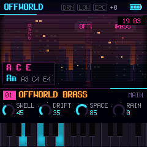
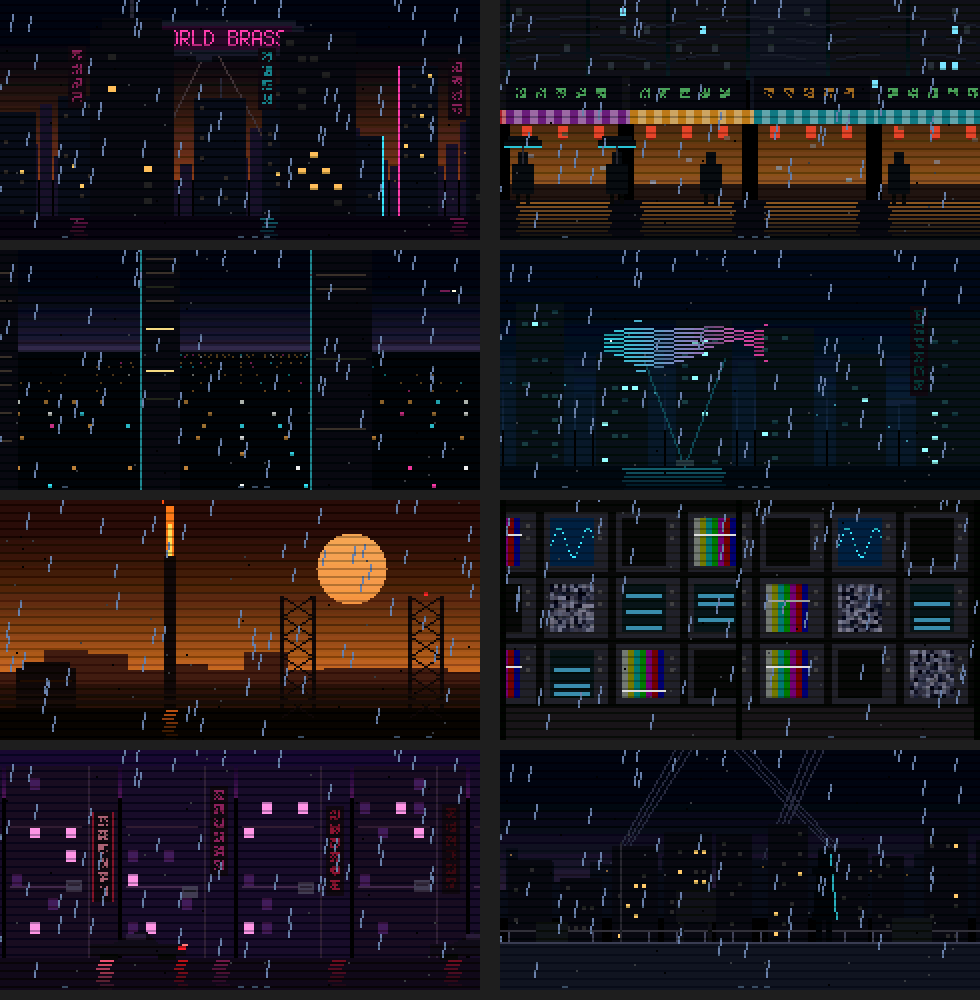
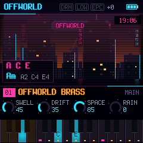
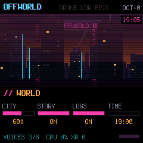
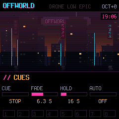

# OFFWORLD – Handbuch

**Eine Firmware für das M-VAVE FM-1 von swtdr34mz.**
Ein Drone-Synth im Geist der großen Science-Fiction-Filmmusik der 80er: kolossale Brass-Flächen, endloser Hall,
Regen auf Neon. Auf dem Display läuft dazu ein Film: eine Stadt bei Nacht, die auf dein Spiel reagiert.

> Inoffiziell: nicht von M-VAVE hergestellt, unterstützt oder geprüft. Die Installation ersetzt die Firmware des
> FM-1 und kann die Garantie kosten. Auf eigene Gefahr.

 

---

## 1. Schnellstart

1. Spiel einen Akkord und halte ihn. Der Klang schwillt an wie ein Bläsersatz.
2. Dreh an **K1–K4**: SWELL, DRIFT, SPACE, RAIN. Langsam gedreht, rastet jeder Regler an guten Stellen ein
   (Sweetspots), ihr Name leuchtet auf.
3. Drück **PLAY** (DRONE): Die Noten bleiben stehen, darunter klingt ein tiefer Grundton. Jetzt hast du beide
   Hände frei für die Regler.
4. Dreh am **PRESET**-Regler: OFFWORLD BRASS, NEON TOWER, PYRAMID HALL, LAST SUNRISE, SKYLINE, DEEP SECTOR,
   ACID SKY.
5. Tipp zweimal auf **HOME**: Das Display zeigt dir alle Bedienelemente mit ihrer Funktion.

## 2. Der Klang

Jede Stimme hat zwei leicht verstimmte Oszillatoren (Sägezahn oder Puls), einen Sub eine Oktave tiefer und ein
24-dB-Filter mit eigener Hüllkurve, die sich langsam öffnet wie ein Bläsersatz. Dahinter liegen ein
Ensemble-Chorus, ein dunkles Ping-Pong-Delay und ein Hall, der bis zu 30 Sekunden ausklingt oder für immer
steht (FREEZE). Synthetischer Regen und ferner Donner gehören dazu. Alles wird in der Firmware erzeugt, ohne Samples.

Wer fester anschlägt, bekommt einen helleren Klang. 8 Stimmen klingen gleichzeitig. Ein Limiter am Ausgang regelt
zu laute Stellen herunter, ohne zu verzerren.

## 3. Die vier Makros (Hauptseite)

| Regler | Makro | Bewegt | Sweetspots |
| --- | --- | --- | --- |
| K1 | **SWELL** | Anschlag von Lautstärke und Filter, wie weit das Filter zurückfällt, Ausklang | STAB, BRASS, SWELL, TIDE, ETERNAL |
| K2 | **DRIFT** | Verstimmung, langsames Wandern der Tonhöhe, Chorus, Stereobreite; am Ende Bandleiern und Dreck | CLEAN, CS, ENSEMBLE, WIDE, BROKEN |
| K3 | **SPACE** | Größe und Länge des Halls, Anteil, Dunkelheit, Delay | ROOM, HALL, CATHEDRAL, CANYON, FREEZE |
| K4 | **RAIN** | Regen: Rauschen, Tropfen, Grollen der Stadt; ab STORM ferner Donner | DRY, DRIZZLE, RAIN, STORM, FLOOD |

Jedes Preset merkt sich seine eigenen Regler. **HOME** eine Sekunde halten setzt das Preset zurück.

## 4. Alle Bedienelemente

| Element | Funktion |
| --- | --- |
| Tasten | Der Synth, mit Anschlag und Druck |
| OCT− / OCT+ | Oktave, −2 bis +1 |
| PRESET | Preset |
| SELECT | TONE: dunkler / heller |
| ALGORITHM | VIBRATO: setzt nach dem Anschlag langsam ein |
| PLAY | **DRONE**: Noten bleiben stehen, eine Taste ohne gedrückte Taste startet einen neuen Akkord; tiefer Grundton darunter |
| SEQ | **LOW HOLD**: Die Noten des Low Split bleiben stehen, eine neue tiefe Note ersetzt sie |
| ARP | **EPIC**: ein Finger spielt Grundton, Quinte und Oktave |
| REC (antippen) | **MEMORY**: die letzten 3 Sekunden werden zu einer schwebenden Wolke eingefroren; nochmal: sie blendet aus |
| REC (1 s halten) | Alle Noten loslassen |
| SAVE | Was gerade klingt, als Cue speichern |
| SEL | Seite **SPLIT** (nochmal: zurück); SEL halten + Taste: der Split dort |
| GLO | Seite **PRESSURE** |
| EDIT | Seite **GLIDE** |
| FX | Seite **WORLD** |
| ENV | Seite **CUES** |
| HOME | Hauptseite; 1 s halten: Preset zurücksetzen; zweimal: alle Bedienelemente auf dem Display |
| MIDI-In | Noten und polyphoner Druck, jeder Kanal (USB oder TRS) |

## 5. SPLIT und die Melodie, die folgt (SEL)

| Regler | Funktion |
| --- | --- |
| SPLIT | AUS, oder die Tasten links vom Split 1 bis 3 Oktaven tiefer |
| POINT | Die erste Taste der rechten Hand (oder SEL halten und eine Taste drücken) |
| SCALE | MINOR, DORIAN, PHRYGIAN, HARM MINOR, MAJOR, LYDIAN, PENTATONIC, ARABIC |
| FOLLOW | OFF; **SNAP**: jede Taste rutscht auf den Skalenton darunter; **WHITE**: die Skala liegt auf den weißen Tasten |

Die tiefste klingende Note des Low Split ist der Grundton, die rechte Hand spielt in dessen Skala. Die Tasten
zeigen es an: Skalentöne leuchten halb, der Grundton hell, der Low Split glimmt. FOLLOW schaltet den Split mit ein.
EPIC bleibt mit FOLLOW in der Skala.

## 6. PRESSURE (GLO)

Fester auf eine Taste drücken, während sie gehalten wird:

| PRESSURE | Wirkung |
| --- | --- |
| FILTER | Das Filter öffnet sich |
| SWELL | Lauter |
| POWER | Lauter, heller, der Chorus geht weit auf, etwas Dreck |
| VIBRATO | Vibrato |

**AMOUNT** stellt ein, wie stark. TONE und VIBRATO liegen hier auch. Ein Balken unten rechts zeigt den Druck.

## 7. GLIDE (EDIT)

| Regler | Funktion |
| --- | --- |
| LOW GLIDE / LOW MODE | Für den Low Split |
| GLIDE / MODE | Für die rechte Hand (ohne Split: die ganze Tastatur) |

Zeit von AUS bis 3 Sekunden. **POLY**: Jede Note bekommt eine eigene Stimme und gleitet von der letzten Note ihrer
Seite. **MONO**: eine Stimme pro Seite, eine neue Taste lässt sie hinübergleiten, ohne neu anzuschlagen. **LEGATO**:
wie MONO, gleitet aber nur, wenn sich die Noten überschneiden. Tipp: LOW HOLD und LOW MODE auf MONO, dann gleitet
der Bass-Drone von Ton zu Ton.

## 8. WORLD (FX): die Stadt hören, die Nacht erleben

| Regler | Funktion |
| --- | --- |
| CITY | Lautstärke der Stadt: jede Szene hat ihren Klang, und was im Bild passiert, hört man (ein Flugauto zieht von der Seite vorbei, auf der es fliegt; eine Flamme faucht; eine Sirene in der Ferne; eine Schüssel an der Theke) |
| STORY | Eine Nacht in 24 Minuten, 19 bis 7 Uhr, mit Uhr im Bild: Dämmerung, Nacht, Regen, Sturm um 1 Uhr, Morgengrauen. RAIN bestimmt, wie wild die Nacht höchstens wird |
| LOGS | Ab und zu tippt das Terminal eine kurze Zeile nach dem Ortsnamen |
| TIME | Stellt die Uhr der Nacht |

## 9. CUES (ENV): eigene Filmmusik

1. Spiel einen Akkord (gehalten oder mit DRONE) und drück **SAVE**: Er wird als Cue gespeichert. Bis zu 8 Cues.
2. **CUE** spielt einen Cue. Jeder Ton gleitet über **FADE** zum nächsten (der tiefste zum tiefsten). STOP beendet.
3. **AUTO** wechselt alle **HOLD** Sekunden zum nächsten Cue.
4. SAVE eine Sekunde halten (auf dieser Seite) löscht alle Cues.

## 10. Der Film

Acht Szenen einer Stadt bei Nacht: Skyline, Nudelstraße, Nachtflug, Hologramm-Koi, Raffinerie, TV-Wand,
Neon-Gasse, Dach mit Suchscheinwerfern. Jede scrollt in mehreren Ebenen. Alle 18 bis 35 Sekunden folgt ein Schnitt
mit Bandstörung, der Ort wird eingetippt. Fenster, Schilder und Bildschirme leuchten mit deinen Noten, Flammen und
Hologramm folgen der Lautstärke, RAIN bringt den Regen, Donner den Blitz.

## 11. Speichern

Einstellungen, Presets und Cues speichern sich selbst. Weil das FM-1 beim Schreiben in den Speicher den Ton kurz
anhält, wartet OFFWORLD dafür auf einen ruhigen Moment (keine Note, kein Cue, kein MEMORY). Wer einen Drone
durchgehend laufen lässt und dann ausschaltet, verliert die letzte Änderung.

## 12. Auf dem Display

Unten stehen die Stimmen (oder Grundton und Skala), **CPU** (Auslastung) und **XR** (zu späte Audioblöcke).

## 13. Noten, Tastatur und Akku auf dem Display

- **Notenschild:** Unten links im Film stehen die Töne, die gerade klingen („A C E“), darunter der Akkord („Am“) und klein die genauen Töne mit Oktave.
- **Tastatur:** Unten im Panel sind die 27 Tasten des FM-1 abgebildet. Was klingt, leuchtet cyan, der Low Split ist bräunlich. Mit FOLLOW zeigen Punkte die Skala (Amber), der Grundton ist magenta. Spielt eine Taste einen anderen Ton als ihren eigenen, steht dieser Ton auf der Taste.
- **Akku (Power Cell):** oben rechts, drei Segmente. Fast leer wird sie rot und flackert, die Stadt verliert ihren Strom (Lichter gehen aus, das Bild wird dunkler) und das Terminal meldet „GRID FAILING“. Beim Laden füllt sie sich grün. Am USB ohne Akku: ein Blitz.
- CPU, XR und der Akku in Prozent stehen auf der Übersicht (HOME zweimal).

---

OFFWORLD von swtdr34mz · MPL-2.0 · Gebaut auf fm1-base (Charles Vestal) und felucca-bsp (Leo Kuroshita,
Hügelton Instruments). Quellcode: https://github.com/swtdr34mz-afk/OFFWORLD
