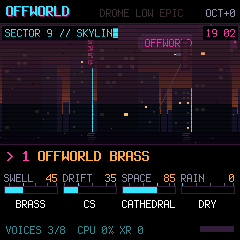
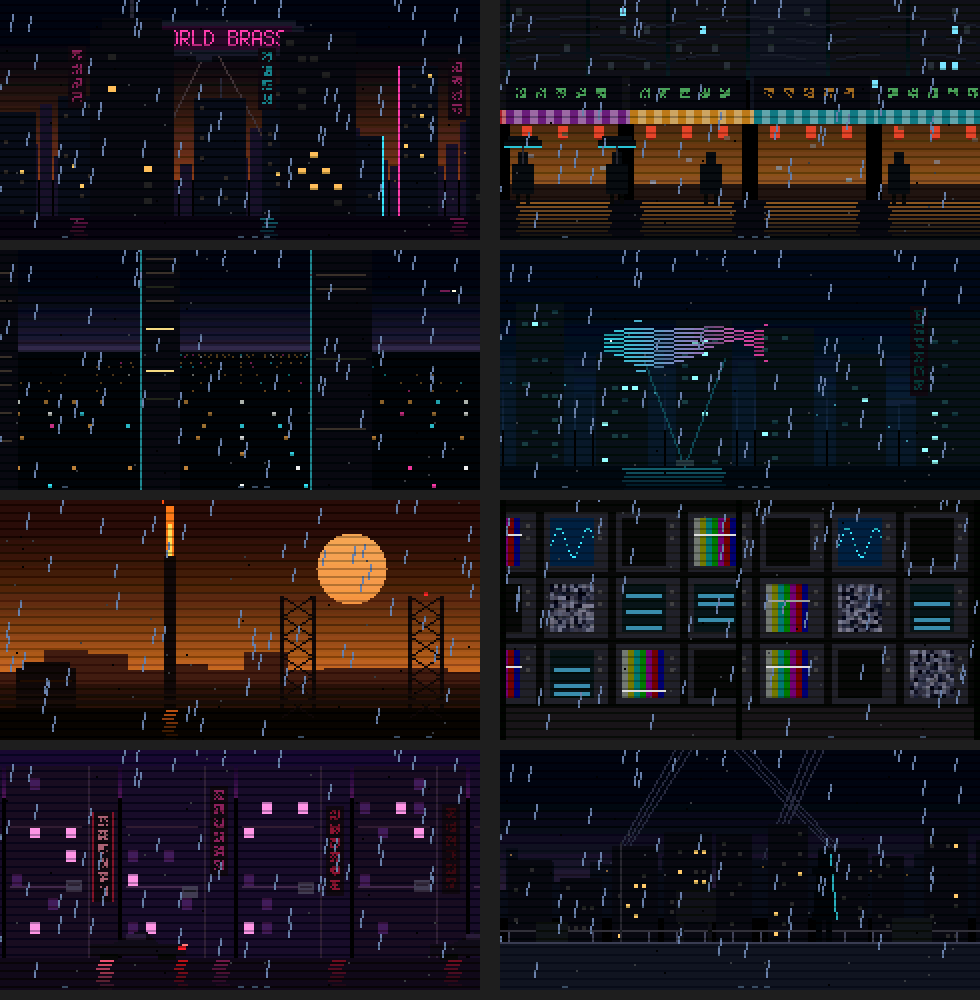

# OFFWORLD – Manual

**A firmware for the M-VAVE FM-1 by swtdr34mz.**
A drone synth in the spirit of the great 80s science-fiction film scores: colossal brass, endless reverb, rain on
neon. On the screen runs a film: a city at night that reacts to your playing.

> Unofficial: not made, supported or checked by M-VAVE. Installing it replaces the FM-1's firmware and may void the
> warranty. At your own risk.

 

---

## 1. Quick start

1. Play a chord and hold it. It swells like a horn section.
2. Turn **K1–K4**: SWELL, DRIFT, SPACE, RAIN. Turned slowly, each knob rests on good places (sweetspots), whose
   names light up.
3. Press **PLAY** (DRONE): the notes stay, a deep root sounds below. Both hands free for the knobs.
4. Turn **PRESET**: OFFWORLD BRASS, NEON TOWER, PYRAMID HALL, LAST SUNRISE, SKYLINE, DEEP SECTOR, ACID SKY.
5. Tap **HOME** twice: the screen shows every control and what it does.

## 2. The sound

Each voice has two slightly detuned oscillators (saw or pulse), a sub an octave down and a 24 dB filter with its own
envelope that opens slowly like a horn section. Behind them: an ensemble chorus, a dark ping-pong delay and a reverb
that rings up to 30 seconds, or forever (FREEZE). Synthesized rain and distant thunder. Everything is generated in
the firmware, no samples.

Harder is brighter. 8 voices at once. A limiter at the output turns loud passages down without distorting.

## 3. The four macros (main page)

| Knob | Macro | Moves | Sweetspots |
| --- | --- | --- | --- |
| K1 | **SWELL** | the attacks (level, filter), how far the filter falls back, the release | STAB, BRASS, SWELL, TIDE, ETERNAL |
| K2 | **DRIFT** | detune, slow pitch drift, chorus, stereo width; at the end tape wow and grit | CLEAN, CS, ENSEMBLE, WIDE, BROKEN |
| K3 | **SPACE** | the reverb's size and length, its mix and darkness, the delay | ROOM, HALL, CATHEDRAL, CANYON, FREEZE |
| K4 | **RAIN** | rain: hiss, drops, the city's rumble; from STORM distant thunder | DRY, DRIZZLE, RAIN, STORM, FLOOD |

Each preset keeps its own knobs. Hold **HOME** for a second to reset the preset.

## 4. All controls

| Control | Function |
| --- | --- |
| Keys | The synth, with velocity and pressure |
| OCT− / OCT+ | Octave, −2 to +1 |
| PRESET | Preset |
| SELECT | TONE: darker / brighter |
| ALGORITHM | VIBRATO: comes in slowly after the attack |
| PLAY | **DRONE**: notes stay; a key with no key down starts a new chord; a deep root below |
| SEQ | **LOW HOLD**: the low split's notes stay; a new low note replaces them |
| ARP | **EPIC**: one finger plays root, fifth and octave |
| REC (tap) | **MEMORY**: the last 3 seconds frozen into a floating cloud; again: it fades |
| REC (hold 1 s) | Every note let go |
| SAVE | What sounds now kept as a cue |
| SEL | **SPLIT** page (again: back); hold SEL + a key: the split there |
| GLO | **PRESSURE** page |
| EDIT | **GLIDE** page |
| FX | **WORLD** page |
| ENV | **CUES** page |
| HOME | Main page; hold 1 s: reset the preset; twice: every control on the screen |
| MIDI in | Notes and polyphonic pressure, any channel (USB or TRS) |

## 5. SPLIT and the melody that follows (SEL)

| Knob | Function |
| --- | --- |
| SPLIT | OFF, or the keys left of the split 1 to 3 octaves down |
| POINT | The right hand's first key (or hold SEL and press a key) |
| SCALE | MINOR, DORIAN, PHRYGIAN, HARM MINOR, MAJOR, LYDIAN, PENTATONIC, ARABIC |
| FOLLOW | OFF; **SNAP**: every key moves to the scale note at or below it; **WHITE**: the scale on the white keys |

The lowest sounding note of the low split is the root; the right hand plays in its scale. The keys show it: scale
notes half lit, the root bright, the low split glowing. FOLLOW turns the split on. EPIC stays in the scale.

## 6. PRESSURE (GLO)

Pressing a held key harder: **FILTER** opens the filter, **SWELL** louder, **POWER** louder, brighter, the chorus wide
open, some grit, **VIBRATO** vibrato. **AMOUNT** says how much. TONE and VIBRATO are here too.

## 7. GLIDE (EDIT)

LOW GLIDE / LOW MODE for the low split, GLIDE / MODE for the right hand (the whole keyboard with the split off). Time
from off to 3 s. **POLY**: every note its own voice, gliding from the last note of its side. **MONO**: one voice a
side; a new key slides it there without a new attack. **LEGATO**: as MONO, gliding only when notes overlap.

## 8. WORLD (FX)

| Knob | Function |
| --- | --- |
| CITY | The city's level: each scene has its sound, and what happens on screen is heard (a car flying past from its side, a flame roaring, a siren far off, a bowl at the counter) |
| STORY | A night in 24 minutes, 19:00 to 07:00, with a clock: dusk, night, rain, the storm at one, dawn. RAIN is how wild the night gets at most |
| LOGS | Now and then the terminal types a short line after the place |
| TIME | Sets the night's clock |

## 9. CUES (ENV)

Play a chord and press **SAVE**: it is kept as a cue (up to 8). **CUE** plays one; each note slides over **FADE** to
the next (lowest to lowest). **AUTO** moves on every **HOLD** seconds. Hold SAVE for a second on this page to clear
every cue.

## 10. The film

Eight scenes of a city at night: skyline, noodle row, night flight, hologram koi, refinery, TV wall, neon alley,
rooftop with searchlights, panning in layers, cut at random with a tape glitch. Windows, signs and screens light with
your notes.

## 11. Saving

Settings, presets and cues save themselves. Because the FM-1 stops its sound for a moment while it writes to its
flash, OFFWORLD waits for a quiet moment (no note, no cue, no MEMORY). Switching off during a long drone loses the
last change.

---

OFFWORLD by swtdr34mz · MPL-2.0 · Built on fm1-base (Charles Vestal) and felucca-bsp (Leo Kuroshita, Hügelton
Instruments). Source: https://github.com/swtdr34mz-afk/OFFWORLD
